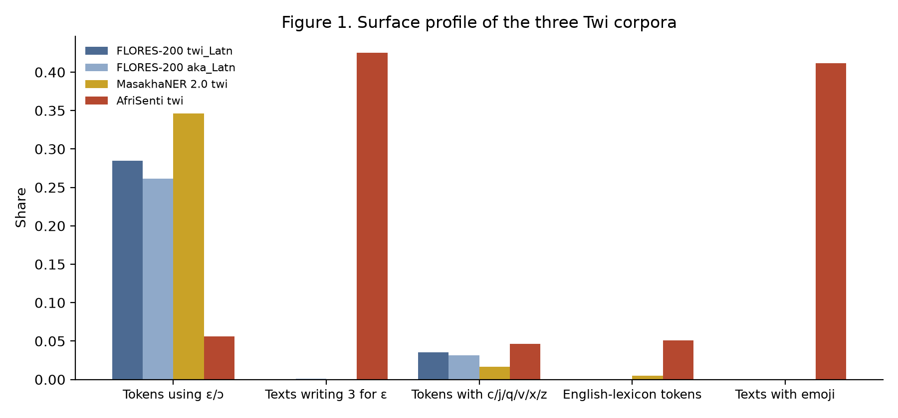
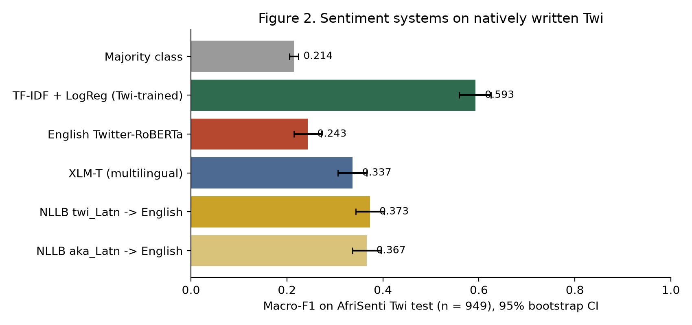
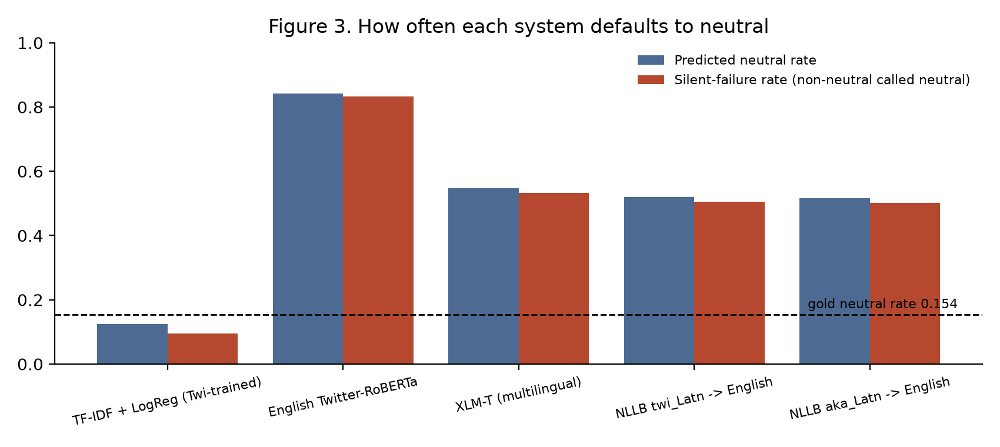
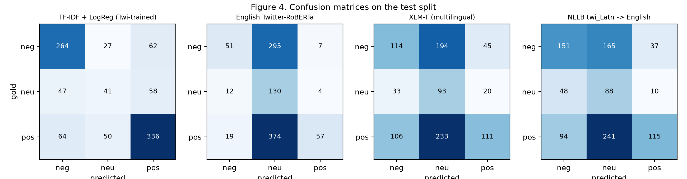
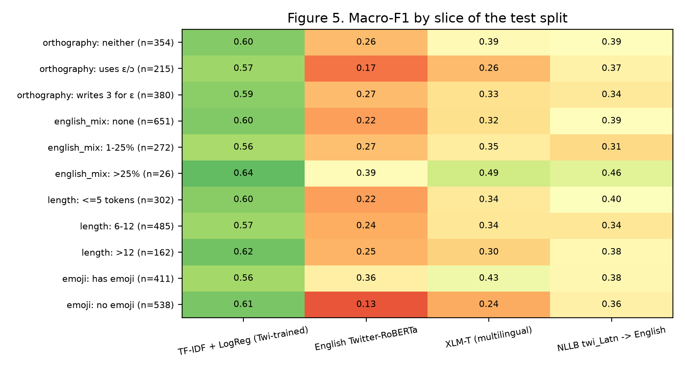

# Translationese All the Way Down

Auditing what "supports Twi" means in social media NLP resources

Gideon Elorm Glago · Student ID 22128981 
Department of Computer Science, University of Ghana 
DCIT 316: Computational Models for Social Media Mining 
Repository: <a href="https://github.com/osamabinIaggin/dcit316-final-project">https://github.com/osamabinIaggin/dcit316-final-project</a>

## Abstract

Google Translate, Meta's NLLB-200 and three human-annotated benchmarks list Twi as a supported
language. This project asks what that support is worth for Twi as it is written on social media.
I audited four resources against six documentation criteria, measured how far the three existing
Twi corpora sit from tweet text, and evaluated five sentiment systems on the 949-tweet
AfriSenti Twi test split. None of the resources names a Twi dialect; FLORES-200 holds two
independent Twi translations under the codes `aka_Latn` and `twi_Latn`; and both benchmarks behind
Twi capability claims are translations into Twi. The tweets differ sharply from them:
42.5% write `3` in place of ɛ, against 0.1% or fewer of
benchmark sentences. On the test split, a TF-IDF and logistic regression baseline trained on Twi
reaches macro-F1 0.593. An English Twitter model reaches
0.243, XLM-T 0.337, and NLLB translation
followed by English classification 0.373 (all p < 0.001 against the
baseline). The off-the-shelf systems fail by predicting neutral: the English model labels
83.3% of positive and negative tweets as neutral. Removing emoji confirms that the English model's few non-neutral calls depend on them: without emoji, 98 of its 125 non-neutral predictions on emoji-bearing tweets become neutral. Rewriting `3` as ɛ stops NLLB copying those spellings into its output, but does not significantly improve the translation pipeline (p = 0.76); it does improve XLM-T (p = 0.027). Declaring the source as `aka_Latn` instead of `twi_Latn` changes the final label for 25.6% of tweets. On this test set, every off-the-shelf system tested falls well short of a simple model trained on 3,481 Twi tweets.

## 1. Introduction

Google Translate added Twi and Ewe in 2022. Meta's NLLB-200 translates both, and its evaluation set,
FLORES-200, carries files for `twi_Latn`, `aka_Latn` and `ewe_Latn`. On the research side, AfriSenti
(Muhammad et al., 2023a), AfriHate (Muhammad et al., 2025) and MasakhaNER 2.0 (Adelani et al., 2022a)
all list Twi among their languages. A student in Accra who wants to analyse Ghanaian online
discourse could fairly conclude that the tools exist.

I wanted to know what that support amounts to for the text people in Ghana actually post. Twi on
social media is short, informal and often mixed with English, and it is often typed without the
letters ɛ and ɔ. AfriSenti's authors put this down to keyboards that lack those letters, and note that
ɛ is typed as `3` and ɔ as `c`. The benchmarks used to evaluate Twi systems are written differently,
as Section 5.3 shows.

A claim that a system "supports Twi" bundles two different things. One is capability: does the
system work on the text you have? The other is accountability: can someone outside the project find
out which Twi was covered, where the text came from, who labelled it and how reliably? Accountability can be checked from documents, while capability needs experiments, so this project
uses both.

The project asks three questions.

- RQ1 (accountability): What do the public resources that claim Twi coverage disclose about the
  language variety, the provenance of the text, the annotators and their agreement?
- RQ2 (distribution): How far is the text these claims are measured on from Twi as it is written
  on social media?
- RQ3 (capability): How do the tools a Ghanaian analyst would reach for perform on natively
  written Twi tweets, compared with a simple baseline trained on Twi?

The project contributes a documentation audit of four resources against six criteria, two of which
(provenance of the text, and comparability of agreement scores) are added here; a measurement of the
distance between the three Twi corpora that exist; and an evaluation of five sentiment systems on
AfriSenti Twi, with an error analysis by orthography, English mixing, length and emoji. All code,
saved predictions, metrics and executed notebooks are in the repository above.

## 2. Related work

 AfriSenti (Muhammad et al., 2023a) and its shared task
(Muhammad et al., 2023b) released sentiment-labelled tweets for 14 African languages; the Twi subset
is the only human-labelled sentiment data for a Ghanaian language I could find. AfriHate (Muhammad et
al., 2025) adds hate and abusive-language labels for 15 languages including Twi. MasakhaNER 2.0
(Adelani et al., 2022a) annotates named entities in 20 languages including Twi and Ewe, and draws the
text for several of them from MAFAND-MT (Adelani et al., 2022b), a corpus of French and English news
translated into African languages.

 FLORES-200 was built for NLLB-200 (NLLB Team et al.,
2022) by translating 2,009 English Wikimedia sentences into roughly 200 languages. Abdulmumin et al.
(2024) had native speakers review the FLORES files for Hausa, Northern Sotho, Xitsonga and isiZulu
and found enough errors to release corrections. No Ghanaian language was covered.

 Caswell et al. (2020) showed that identifiers which score well on
held-out sets can produce web corpora in which most text labelled as a low-resource language is
something else. Burchell et al. (2024) found that identifying languages in code-switched text
remains unsolved. Both matter here because AfriSenti assigned most of its Twi tweets to Twi with a
model trained on 2,000 hand-labelled examples.

 The English model evaluated here comes from the TimeLMs series
(Loureiro et al., 2022), fine-tuned on the TweetEval sentiment task (Barbieri et al., 2020). XLM-T
(Barbieri et al., 2022) continues training XLM-R on multilingual tweets and fine-tunes it for
sentiment in eight languages, none of them African.

 Data statements (Bender and Friedman, 2018), datasheets (Gebru et al.,
2021) and model cards (Mitchell et al., 2019) set out what dataset and model creators should record.
The audit criteria in Section 4.1 build on them.

The African NLP literature reports what systems achieve on its benchmarks, and the documentation
literature says what should be disclosed. I found no work that checks Ghanaian-language claims
against both the documentation and the text Ghanaians write.

## 3. Data and ethics

| Source | What is used | Size | Natively written? |
|---|---|---|---|
| AfriSenti Twi, commit `5aec3cf` | Tweets with sentiment labels | 3,481 train, 388 dev, 949 test | Yes |
| MasakhaNER 2.0 Twi, commit `ba5843c` | Sentences only, no entity labels | 6,056 sentences | No (MAFAND-MT translation) |
| FLORES-200 `twi_Latn`, `aka_Latn`, `eng_Latn` | dev + devtest | 2,009 sentences each | No (translated from English) |
| Four papers (AfriSenti, AfriHate, MasakhaNER 2.0, FLORES correction) | Text extracted from the PDFs | n/a | n/a |

The AfriSenti Twi test split holds 450 positive,
353 negative and 146
neutral tweets. Its reported inter-annotator agreement is 0.51 (free-marginal kappa).

AfriSenti collected its Twi tweets through the Twitter Academic API with location-based heuristics
for the countries where each language is spoken (Ghana for Twi), combined with stopword lists and
sentiment lexicons. The release carries no per-tweet location, so the corpus supports claims about
Twi tweets collected around Ghana; it cannot confirm that any individual author is Ghanaian.
Collecting through sentiment lexicons may also favour emotional tweets, which would be one
explanation for the small neutral class (15%); I have not tested that.

I did not create an independently labelled test sample. I speak and read Twi, but I am not a trained
annotator, and a sample labelled by me alone would set one untrained rater against AfriSenti's three
native-speaker annotators, whose own agreement is κ = 0.51. Every capability result therefore rests on AfriSenti's own
labels, and Section 8 treats that as a limitation.

Everything is public. `scripts/fetch_data.py` downloads each file from a pinned commit and records a
SHA-256 checksum, so no raw data is committed; the AfriSenti and MasakhaNER repositories declare no
licence, and I did not want to redistribute text I had no explicit permission to share. AfriSenti
tweets carry no user handles or links (none of the 4,818 tweets contains one). No new data was
collected and no person was contacted. The few tweets quoted in Section 7 are already distributed in
a public benchmark and identify nobody.

I speak Twi but I am not a trained translator, so I did not grade NLLB's translations, and no result
depends on my own reading of Twi text. Where a translation judgement would be needed, the paper says
so. The full data card, ethics
statement and AI-use disclosure are in the repository.

## 4. Methods

### 4.1 Documentation audit (RQ1)

Each paper is converted to text twice with `pdftotext`: once with `-layout`, which keeps tables
intact, and once in reading order, because `-layout` interleaves the two columns of an ACL paper and
breaks any sentence that wraps. `scripts/audit_documentation.py` searches both for patterns tied to
six criteria and saves every matching line with its line number.

| | Criterion | Basis |
|---|---|---|
| A1 | Is the language referent precise (Akan, Twi, a named dialect)? | Bender and Friedman (2018) |
| A2 | Is the text natively written or translated? | Added here |
| A3 | Are native-speaker annotators stated? | Gebru et al. (2021) |
| A4 | Is agreement reported, and in a form comparable across resources? | Added here |
| A5 | Is annotator pay disclosed? | Gebru et al. (2021) |
| A6 | Is there a datasheet, data statement or model card? | Gebru et al. (2021); Mitchell et al. (2019) |

The search is automatic; each verdict in the matrix is my reading of the matches, and the matches are
committed so the reading can be checked. "Not found" means the fact is absent from the public paper,
not that the practice did not happen.

### 4.2 Domain ladder (RQ2)

The three Twi corpora differ in how far they sit from spontaneous writing: FLORES-200 is translated
encyclopaedic prose, MasakhaNER 2.0 is translated news, and AfriSenti is tweets. For every text I
compute the share of tokens using ɛ or ɔ, whether the text writes `3` inside a word in place of ɛ,
the share of tokens containing letters outside the Twi alphabet (c, j, q, v, x, z), the share of
emoji-bearing texts, and an English-token share. The English lexicon is FLORES English plus
scikit-learn's stop-word list, minus every word that appears in FLORES Twi or Akan; this makes the
estimate zero on FLORES by construction, so it is only compared across the other two corpora. I also
measure how much of the tweets' vocabulary each benchmark covers, and how similar the FLORES
`aka_Latn` and `twi_Latn` files are.

### 4.3 Sentiment systems (RQ3)

All systems are scored on the 949-tweet AfriSenti Twi test split, which is used once.

| System | What it is | Role |
|---|---|---|
| Majority class | Most frequent training label (positive) | Floor |
| TF-IDF + logistic regression | Character 2- to 5-grams plus word unigrams and bigrams, class-balanced, C chosen on dev | Baseline, trained on Twi |
| English-only | `cardiffnlp/twitter-roberta-base-sentiment-latest`, applied directly to Twi | What an analyst uses by default |
| XLM-T | `cardiffnlp/twitter-xlm-roberta-base-sentiment`, zero-shot | Multilingual, no Twi training |
| NLLB → English | `nllb-200-distilled-600M` translates Twi to English, then the English-only model | Translate-then-classify |

The baseline's word features use scikit-learn's default token pattern, which keeps only runs of two
or more word characters and so discards emoji and punctuation. The character n-grams keep them.
Section 4.4 tests whether keeping emoji in the word features matters.

The NLLB pipeline is run twice on identical input, once declaring the source as `twi_Latn` and once
as `aka_Latn`, because FLORES treats these as separate languages and no resource says which one
tweets belong to. Decoding is greedy with at most 96 new tokens.

Macro-F1 is the primary metric because the classes are unbalanced; accuracy, weighted
F1 and per-class F1 are also reported. A 95% bootstrap interval (1,000 resamples, seed 22128981)
accompanies each macro-F1, and an exact McNemar test compares each system with the baseline. I also
report a silent-failure rate: of the tweets whose gold label is positive or negative, the share
predicted neutral. This error produces no warning, because a confident "neutral" looks like an
ordinary answer.

For the error analysis, the test split is cut by orthography (uses ɛ/ɔ, writes `3` for ɛ, neither), by
English-token share, by length and by the presence of emoji, and macro-F1 is computed per slice.
Samples of three error types are saved for inspection: sentiment lost through translation, tweets
every non-trivial system gets wrong, and label changes caused only by the declared source language.

### 4.4 Robustness checks

The error analysis proposes causes, and correlation within a slice does not establish them, so
`scripts/run_robustness.py` tests each one by intervention.

- R1, emoji ablation: remove every emoji from the test tweets and rerun the English-only model and
  XLM-T. If their non-neutral predictions depend on emoji, they should turn neutral; predictions on
  tweets that had no emoji should not change at all.
- R2, spelling fix: in the 387 tweets that write `3`
  inside a word, replace it with ɛ (`s3` becomes `sɛ`, `y3di` becomes `yɛdi`), then rerun NLLB with the
  English model, and XLM-T. This is a heuristic rewrite; I cannot check each result by reading it.
- R3: an exact McNemar test between the `twi_Latn` and `aka_Latn` runs.
- R4: retrain the baseline with character features only, word features only, both, and both with a
  word token pattern that keeps emoji. C is chosen on dev each time.

## 5. Results

### 5.1 Coverage

| Language | FLORES-200 | MasakhaNER 2.0 | AfriSenti | AfriHate | Google Translate | NLLB-200 |
|---|---|---|---|---|---|---|
| Twi / Akan | yes (two files) | yes | yes | yes | yes (2022) | yes |
| Ewe | yes | yes | no | no | yes (2022) | yes |
| Ga | no | no | no | no | no | no |
| Dagbani | not confirmed | no | no | no | no | no |

*Table 1. Which Ghanaian languages each resource claims. Ga's absence from FLORES-200 was checked
against the released file list; Dagbani was not checked against every resource.*

Ga is the language of Accra, the country's largest urban area, and none of these resources covers
it. Ewe has benchmark files but no social media data, so nothing in this paper's experiments could
be repeated for it.

### 5.2 Documentation audit (RQ1)

| Criterion | FLORES-200 | AfriSenti | AfriHate | MasakhaNER 2.0 |
|---|---|---|---|---|
| A1 Language referent | Two files, `aka_Latn` and `twi_Latn`; no dialect | "Twi", no dialect | "Twi", no dialect | "Akan/Twi", no dialect |
| A2 Natively written | No, translated from English | Yes, tweets | Yes, tweets | No, MAFAND-MT translation |
| A3 Native-speaker annotators | Human-verified translation | Yes | Yes | Yes |
| A4 Agreement | n/a | κ = 0.51 | 0.46 to 0.81 across languages | κ = 0.932, after adjudication |
| A5 Annotator pay disclosed | Not found | Not found | "more than the minimum wage" | "appropriate remuneration" |
| A6 Datasheet or data statement | Not found | Not found | Not found | Not found |

*Table 2. Disclosure matrix. Evidence lines for every cell are in `reports/evidence/`.*

#### Language variety

FLORES-200 has two files, `aka_Latn` and `twi_Latn`. They are not copies:
only 8 of 2,009 lines are
identical, and the Jaccard similarity of their vocabularies is
0.36. MasakhaNER 2.0 merges the two names into "Akan/Twi";
AfriSenti and AfriHate say "Twi". None of the four papers mentions Akuapem, Asante or Fante, the
varieties a Ghanaian reader would ask about.

#### Where the text comes from

FLORES-200 is English Wikimedia text translated into Twi. For
Twi, MasakhaNER 2.0 uses MAFAND-MT, which its paper describes as "French and English news articles
translated into 11 languages". The authors add: "We note that translationese may lead to undesired
properties, e.g., unnaturalness. However, we did not observe serious issues during the annotation."
That second sentence is about whether annotators could label the text reliably. It says nothing
about whether the text resembles Twi as people write it, which is the property at issue here. The
only natively written Twi among the four resources is in the two Twitter collections.

#### Annotation of the tweets

AfriSenti's authors write that "a
significant portion of tweets in Twi were ambiguous, making it difficult to categorize sentiment
accurately", and report κ = 0.51 for Twi. They also explain that native speakers labelled 2,000
tweets as Twi or not, and a model trained on those labels assigned the rest, which is the setting
Caswell et al. (2020) warn about.

#### Agreement scores

MasakhaNER 2.0's κ = 0.932 for Twi is measured after
language coordinators resolved disagreements; the paper says the pre-intervention score "was much
lower" and gives one example (Nigerian Pidgin, 0.648 before and 0.966 after). AfriSenti's 0.51 is a
free-marginal kappa with no adjudication step described. A reader choosing between the corpora on
reported agreement would be comparing two different quantities.

#### Datasheets and pay

The A6 search found no datasheet, data statement or data card in any of the four
papers. AfriHate and MasakhaNER 2.0 disclose that annotators were paid; AfriSenti does not say.

### 5.3 Distance from social media text (RQ2)

| Corpus | Texts | Mean tokens | Tokens with ɛ/ɔ | Texts writing `3` for ɛ | Tokens with c/j/q/v/x/z | Texts with emoji |
|---|---|---|---|---|---|---|
| FLORES-200 `twi_Latn` | 2009 | 25.3 | 28.5% | 0.1% | 3.5% | 0.0% |
| FLORES-200 `aka_Latn` | 2009 | 25.8 | 26.1% | 0.1% | 3.1% | 0.0% |
| MasakhaNER 2.0 Twi | 6056 | 23.4 | 34.6% | 0.0% | 1.7% | 0.0% |
| AfriSenti Twi | 4818 | 9.3 | 5.6% | 42.5% | 4.6% | 41.2% |

*Table 3. Surface profile of the three Twi corpora (`reports/metrics/ladder_profile.csv`).*

Tweets average fewer than half as many tokens as benchmark sentences.
In the benchmarks, between 26.1% and
34.6% of tokens contain ɛ or ɔ; in the tweets,
5.6% do, and 42.5%
of tweets write `3` inside a word instead. The English-token estimate is
5.1% for the tweets and
0.5% for MasakhaNER (it is zero for FLORES by
construction). Vocabulary overlap is low: FLORES `twi_Latn` covers
15.4% of the word types in the tweets
(51.4% of tokens), and MasakhaNER covers
21.9%.

### 5.4 Sentiment systems on natively written Twi (RQ3)

| System | Accuracy | Macro-F1 [95% CI] | F1 neg / neu / pos | Predicted neutral | Silent failure | McNemar p vs baseline |
|---|---|---|---|---|---|---|
| Majority class | 0.474 | 0.214 [0.205, 0.224] | 0.00 / 0.00 / 0.64 | 0.0% | 0.0% | < 0.001 |
| TF-IDF + LogReg (baseline) | 0.675 | 0.593 [0.559, 0.625] | 0.73 / 0.31 / 0.74 | 12.4% | 9.6% | n/a |
| English-only | 0.251 | 0.243 [0.215, 0.271] | 0.23 / 0.28 / 0.22 | 84.2% | 83.3% | < 0.001 |
| XLM-T | 0.335 | 0.337 [0.306, 0.367] | 0.38 / 0.28 / 0.35 | 54.8% | 53.2% | < 0.001 |
| NLLB `twi_Latn` → English | 0.373 | 0.373 [0.343, 0.403] | 0.47 / 0.28 / 0.38 | 52.1% | 50.6% | < 0.001 |
| NLLB `aka_Latn` → English | 0.367 | 0.367 [0.336, 0.396] | 0.46 / 0.27 / 0.36 | 51.5% | 50.1% | < 0.001 |

*Table 4. AfriSenti Twi test split, n = 949. Gold neutral rate
15.4%. Silent failure: share of positive or negative tweets predicted
neutral. C = 4.0 was chosen on dev.*

The baseline trained on 3,481 Twi tweets reaches macro-F1 0.593. No
system that claims wider coverage comes close: translate-then-classify reaches
0.373, XLM-T 0.337, and the English-only model
0.243, just above the majority-class floor of
0.214. Every difference from the baseline is significant (McNemar
p < 0.001), and none of the confidence intervals overlaps the baseline's.

The off-the-shelf systems fail towards neutral. Only 15.4% of test tweets are neutral, yet
the English-only model predicts neutral for 84.2% of
them and turns 83.3% of the positive and negative tweets
into neutral. XLM-T and the NLLB pipeline do the same to about half
(53.2% and 50.6%). Averaged
over a corpus, this would report Twi speakers as far calmer than they are, and nothing in the
output would show it.

## 6. Error analysis

| Slice | n | Baseline | English-only | XLM-T | NLLB twi |
|---|---|---|---|---|---|
| Uses ɛ/ɔ | 215 | 0.568 | 0.170 | 0.264 | 0.366 |
| Writes `3` for ɛ | 380 | 0.591 | 0.265 | 0.326 | 0.345 |
| Neither | 354 | 0.601 | 0.263 | 0.385 | 0.394 |
| Has emoji | 411 | 0.562 | 0.362 | 0.434 | 0.380 |
| No emoji | 538 | 0.614 | 0.129 | 0.239 | 0.363 |
| English share >25% | 26 | 0.643 | 0.389 | 0.492 | 0.461 |
| No English | 651 | 0.605 | 0.224 | 0.324 | 0.394 |

*Table 5. Macro-F1 by slice (`reports/metrics/slices.csv`; all slices in Figure 5).*

#### Emoji

On tweets without emoji it predicts neutral for
95.3% of them and scores
0.129; with emoji it scores
0.362. That pattern suggested the model was relying on
emoji; Section 6.1 confirms it by removing them. Its errors fall slightly as the English share
rises (0.389 above 25%, from
0.224 with none), but that slice holds only
26 tweets.

#### Spelling and translation

Of the
387 test tweets that write `3` for ɛ,
188 (48.6%)
come back from NLLB with those words still in them: `s3`, `de3`, `y3di` reach the English classifier
as unknown strings. Those tweets are then called neutral 60.1% of
the time, against 46.7% when the spelling
was absorbed. This is a correlation; Section 6.1 tests whether fixing the spelling helps.
Standard orthography does not rescue translation either: on tweets that use ɛ/ɔ the NLLB pipeline
scores 0.366.

#### Declared source language

Translating the same tweets as `twi_Latn` and as
`aka_Latn` gives identical output for only 120 of
949. The final sentiment label differs for
243 tweets (25.6%),
while overall macro-F1 is 0.373 and
0.366. An exact McNemar test finds no evidence that either code is
more accurate (p = 0.69); with 949 tweets that does not show
the two are equivalent, and the choice clearly changes which tweets are labelled correctly. An analyst who picks the other code gets a different label for one tweet in four, and nothing in
the documentation reviewed in Section 5.2 says which code is right.

#### The baseline

Its macro-F1 stays between 0.55 and 0.65 on every slice, including the
spelling variants that defeat translation. Its weak point is the neutral class (F1
0.31), the smallest and, given κ = 0.51, probably the noisiest.

#### Tweets every system gets wrong

132 tweets are misclassified by the
baseline, XLM-T and the NLLB pipeline alike. Samples are saved in `reports/error_analysis/`. I did not relabel them, so the paper does not say whether the systems or the gold labels are wrong. The
creators' note that many Twi tweets are ambiguous makes label error a plausible explanation for some
of them, but I have not verified a single annotation error, and the paper makes no claim that any
specific label is wrong.

### 6.1 Testing the proposed causes

| Check | Before | After | McNemar p |
|---|---|---|---|
| R1 English-only, tweets with emoji (n = 411): macro-F1 | 0.362 | 0.161 | < 0.001 |
| R1 English-only: predicted neutral | 69.6% | 92.5% | |
| R1 XLM-T, tweets with emoji: macro-F1 | 0.434 | 0.272 | < 0.001 |
| R2 NLLB pipeline, tweets with `3` (n = 387): macro-F1 | 0.342 | 0.349 | 0.76 |
| R2 NLLB pipeline: translations still containing `3` spellings | 188 | 2 | |
| R2 NLLB pipeline: predicted neutral | 53.2% | 47.3% | |
| R2 XLM-T, tweets with `3`: macro-F1 | 0.322 | 0.362 | 0.027 |

*Table 6. Interventions (`reports/metrics/robustness.json`).*

Removing emoji confirms the emoji explanation. Of the English model's
125 non-neutral predictions on
emoji-bearing tweets, 98 become neutral,
and its predictions on the 538 emoji-free tweets do
not change (538 of
538), which rules out run-to-run variation as the
source of the drop. XLM-T leans on emoji as well:
96 of its
211 non-neutral calls disappear.

The spelling fix gives a mixed result. It stops NLLB copying `3` spellings (from
188 translations to
2) and lowers the neutral rate,
yet the pipeline's macro-F1 barely moves and the McNemar test finds no significant change. The
copied spellings are therefore not shown to cause the pipeline's errors; something else in the
translation or the English classifier limits it. The same rewrite does help XLM-T, which reads Twi
directly: macro-F1 rises from 0.322 to
0.362 (p = 0.027).
For a multilingual model applied to Twi tweets, normalising `3` to ɛ is a cheap fix with measured
benefit on this data; it still leaves XLM-T far below the baseline.

| Baseline variant | C (dev) | Test macro-F1 [95% CI] |
|---|---|---|
| Character n-grams only | 8.0 | 0.578 [0.548, 0.609] |
| Word n-grams only | 4.0 | 0.569 [0.537, 0.602] |
| Both (reported baseline) | 4.0 | 0.593 [0.559, 0.625] |
| Both, word tokens keep emoji | 4.0 | 0.585 [0.553, 0.617] |

*Table 7. Baseline feature ablation.*

The baseline's lead does not depend on its feature set. Each variant scores between
0.569 and 0.593, the intervals
overlap, and the weakest variant is still more than 0.19 above the best off-the-shelf system. Keeping
emoji in the word features produced no measurable gain, probably because the character n-grams
already contain them.

## 7. Discussion

The resources that claim Twi measure their claims on
translated, standard-orthography prose (RQ1, RQ2), while Twi online is short, mixed with English and
emoji, and spelled with digits in place of letters (RQ2). On that text, each of the four off-the-shelf configurations tested scores far below a small model
trained on 3,481 tweets, mostly by turning sentiment into neutral (RQ3). That is a result for these
systems on this test set. It does not show that no multilingual model could do better; an
Africa-centric model fine-tuned on AfriSenti was not tested.

For anyone mining Ghanaian social media, the evidence here argues against using these off-the-shelf
pipelines on Twi without first checking them on labelled Twi tweets. On this data a modest amount of
in-domain labelled data, with a linear model, did better than all of them. The pressing work is
collecting and labelling more natively written text, for Twi and especially for Ga and Ewe, where
none exists.

The documentation findings explain why this is hard to see from the outside. A model card that
reports FLORES scores for `twi_Latn` reports performance on translated Wikipedia sentences, in one of
two unlabelled Twi files, with no statement of the variety. A practitioner cannot tell from it how the model will
behave on tweets, or that switching to `aka_Latn` changes a quarter of the labels.

These teams documented more than most of the field does, and that openness is what made this audit
possible. The commercial systems whose claims reach the most users disclose the least, and one of
them, Google Translate, could not be tested here at all.

## 8. Limitations

- "Not found" in Table 2 means the fact is missing from the
  public paper. The practice may have happened.
- No independently labelled sample. Every capability result depends on AfriSenti's labels (κ = 0.51 for Twi, with
  ambiguity noted by the authors). Some of what looks like system error is probably label noise.
- I did not grade NLLB's translations, so the NLLB results show that sentiment was lost, not that a
  translation was wrong.
- Sentiment on one Twitter corpus. Hate speech (AfriHate Twi) and other
  tasks could behave differently.
- XLM-T was not trained on any African language; an Africa-centric model
  fine-tuned for sentiment might do much better. Google Translate was not tested because I had no
  API key. Language identifiers (AfroLID, GlotLID) were not run.
- The English-token estimate and the orthography slices are
  heuristics, tested in `tests/`, but not validated against human judgement.
- AfriSenti releases no per-tweet location, and its lexicon-based collection may over-sample
  emotional tweets. Both limit how far the results generalise to Ghanaian Twitter as a whole.
- The spelling fix in R2 is a heuristic rewrite that I could not check by reading the output.
- Ga's absence was checked against FLORES-200's file list; Dagbani was not checked
  everywhere. GhanaNLP corpora and the Khaya translator were not audited.

## 9. Conclusion

Twi is listed as supported by the largest translation systems and by three human-annotated
benchmarks. The benchmarks those claims rest on are translations into Twi, written in a spelling
that most Twi tweets do not use, under two language codes that nobody distinguishes, and the
agreement scores attached to them cannot be compared. On 949 natively written Twi tweets, an English-only model, a multilingual model and a
translate-then-classify pipeline all scored well below a TF-IDF baseline trained on Twi, mostly by
calling emotional tweets neutral. For the English model, removing emoji showed that its few
non-neutral calls came from the emoji.

What is missing is data written the way Ghanaians write, a convention for naming the variety, and
agreement reported in comparable form. Until those exist, anyone analysing Twi on social media should check their tools on labelled Twi
tweets, and on this evidence a small in-domain model is a stronger starting point than the
off-the-shelf systems tested.

## References

Abdulmumin, I., Mkhwanazi, S., Mbooi, M. S., Muhammad, S. H., Ahmad, I. S., Putini, N., Mathebula, M., Shingange, M., Gwadabe, T., and Marivate, V. (2024). Correcting FLORES evaluation dataset for four African languages. arXiv:2409.00626.

Adelani, D. I., Neubig, G., Ruder, S., Rijhwani, S., et al. (2022a). MasakhaNER 2.0: Africa-centric transfer learning for named entity recognition. In *Proceedings of EMNLP 2022*, 4488-4508.

Adelani, D. I., Alabi, J. O., Fan, A., Kreutzer, J., et al. (2022b). A few thousand translations go a long way! Leveraging pre-trained models for African news translation. In *Proceedings of NAACL 2022*, 3053-3070.

Barbieri, F., Camacho-Collados, J., Espinosa Anke, L., and Neves, L. (2020). TweetEval: Unified benchmark and comparative evaluation for tweet classification. In *Findings of EMNLP 2020*, 1644-1650.

Barbieri, F., Espinosa Anke, L., and Camacho-Collados, J. (2022). XLM-T: Multilingual language models in Twitter for sentiment analysis and beyond. In *Proceedings of LREC 2022*, 258-266.

Bender, E. M., and Friedman, B. (2018). Data statements for natural language processing: Toward mitigating system bias and enabling better science. *Transactions of the ACL*, 6, 587-604.

Burchell, L., Birch, A., Thompson, R., and Heafield, K. (2024). Code-switched language identification is harder than you think. In *Proceedings of EACL 2024*, 646-658.

Caswell, I., Breiner, T., van Esch, D., and Bapna, A. (2020). Language ID in the wild: Unexpected challenges on the path to a thousand-language web text corpus. In *Proceedings of COLING 2020*, 6588-6608.

Gebru, T., Morgenstern, J., Vecchione, B., Vaughan, J. W., Wallach, H., Daumé III, H., and Crawford, K. (2021). Datasheets for datasets. *Communications of the ACM*, 64(12), 86-92.

Loureiro, D., Barbieri, F., Neves, L., Espinosa Anke, L., and Camacho-Collados, J. (2022). TimeLMs: Diachronic language models from Twitter. In *Proceedings of ACL 2022: System Demonstrations*, 251-260.

Mitchell, M., Wu, S., Zaldivar, A., Barnes, P., Vasserman, L., Hutchinson, B., Spitzer, E., Raji, I. D., and Gebru, T. (2019). Model cards for model reporting. In *Proceedings of FAT* 2019*, 220-229.

Muhammad, S. H., Abdulmumin, I., Ayele, A. A., Ousidhoum, N., Adelani, D. I., Yimam, S. M., et al. (2023a). AfriSenti: A Twitter sentiment analysis benchmark for African languages. In *Proceedings of EMNLP 2023*, 13968-13981.

Muhammad, S. H., Abdulmumin, I., Yimam, S. M., Adelani, D. I., Ahmad, I. S., Ousidhoum, N., Ayele, A. A., Mohammad, S. M., Beloucif, M., and Ruder, S. (2023b). SemEval-2023 Task 12: Sentiment analysis for African languages (AfriSenti-SemEval). In *Proceedings of SemEval-2023*, 2319-2337.

Muhammad, S. H., Abdulmumin, I., Ayele, A. A., Adelani, D. I., et al. (2025). AfriHate: A multilingual collection of hate speech and abusive language datasets for African languages. In *Proceedings of NAACL 2025*, 1854-1871.

NLLB Team, Costa-jussà, M. R., Cross, J., Çelebi, O., Elbayad, M., et al. (2022). No language left behind: Scaling human-centered machine translation. arXiv:2207.04672.
